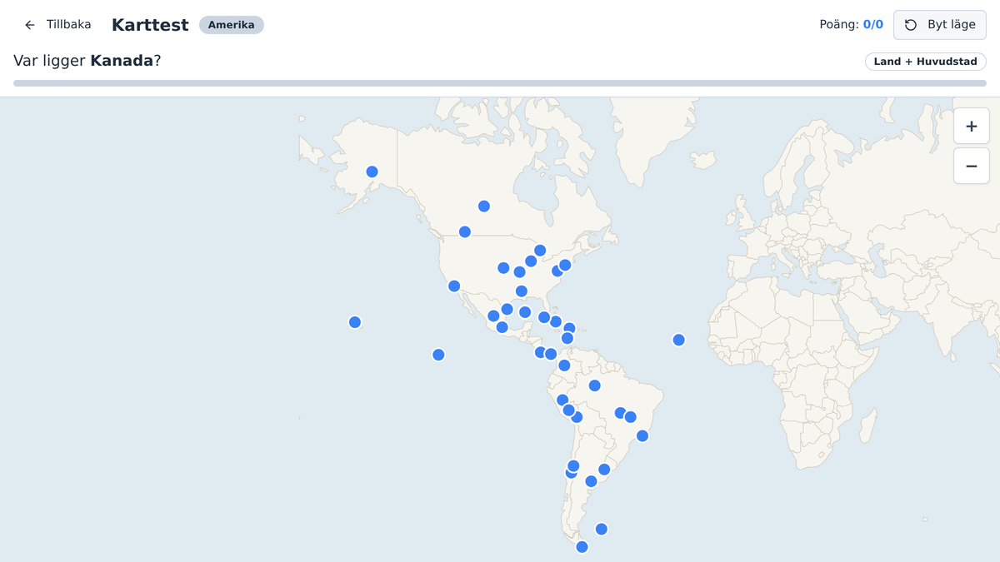

# Karttest

Ett karttest i geografi för mellanstadiet och uppåt. Eleven får namnet på ett land, en
huvudstad, en flod eller ett berg och klickar på kartan där platsen ligger. Fyra världsdelar,
runt 200 platser, ingen inloggning.

**Spela:** https://karttest.skolappar.org · En del av [Skolappar](https://www.skolappar.org) – pedagogiska appar av föräldrar · öppen källkod (MIT)



Körs fristående, med en egen offlinekarta.

## Vad du kan göra

- **Välja världsdel**: Amerika, Europa, Afrika, Asien eller alla på en gång.
- **Välja kategori**, till exempel länder, huvudstäder, floder, sjöar, hav, öar, öknar,
  bergskedjor och berg.
- **Studera**: alla platser visas med namn på kartan och i en lista. Ingen poäng, ingen tid.
- **Testa**: "Var ligger …?" – klicka på rätt prick och få svar direkt. Vid fel visas rätt
  plats i grönt. Poäng och förloppsindikator under tiden.
- **Öva på felen**: efter rundan listas de platser du missade, och du kan köra dem igen.
- **Zooma** med + / − (bra på mobilen, där prickarna annars blir små).
- **Egna platser**: ladda upp en textfil eller klistra in en lista. Det räcker med namnen –
  koordinaterna slås upp i ett inbyggt register. Saknas ett namn kan du skriva koordinater
  själv eller slå upp det via OpenStreetMap. Exempelfil går att ladda ner.

## Kom igång

```bash
npm install
npm run dev        # utvecklingsserver
npm run build      # produktionsbygge till dist/
npm run build:dev  # bygge i utvecklingsläge
npm run preview    # förhandsgranska bygget
npm run lint       # eslint
```

Docker-bygget använder Node 22.

## Docker

```bash
docker build -t karttest .
docker run --rm -p 8080:8080 karttest
```

Servern ligger bakom nginx med `deploy/nginx.conf`.

## Integritet

- Ingen spårning, inga kakor, ingen analys, inget konto, ingen AI.
- Kartan ritas lokalt från `world-atlas` med `d3-geo` – inga karttjänster eller API-nycklar.
- Typsnittet Fredoka ligger i appen (`public/fonts/`).
- Egna platser sparas bara i `sessionStorage` under nyckeln `karttest:egna-platser` och
  försvinner när fliken stängs.
- Enda nätverksanropet: knappen "Slå upp via OpenStreetMap" skickar de namn som saknas i
  registret till `nominatim.openstreetmap.org`. Den körs bara om du trycker på den.

## Struktur

```
src/
  pages/Landing.tsx         startsida: välj världsdel, egna platser
  pages/Quiz.tsx            läser världsdel eller egna platser ur URL:en
  pages/Egna.tsx            sida för egna platser
  components/Karttest.tsx   spelet: kategori, studera/testa, poäng, öva på fel
  components/MapCanvas.tsx  SVG-karta, prickar, zoom, klick på närmaste prick
  components/StudyView.tsx  studera-läget med namnlista
  components/OwnPlaces.tsx  uppladdning, tolkning och OpenStreetMap-uppslag
  data/*Questions.ts        platser per världsdel
  data/gazetteer.ts         register för namnuppslag
  lib/parsePlaces.ts        tolkar textfiler, sessionStorage
deploy/nginx.conf           nginx-konfiguration för Docker
```

## Licens

MIT – se [LICENSE](LICENSE).
